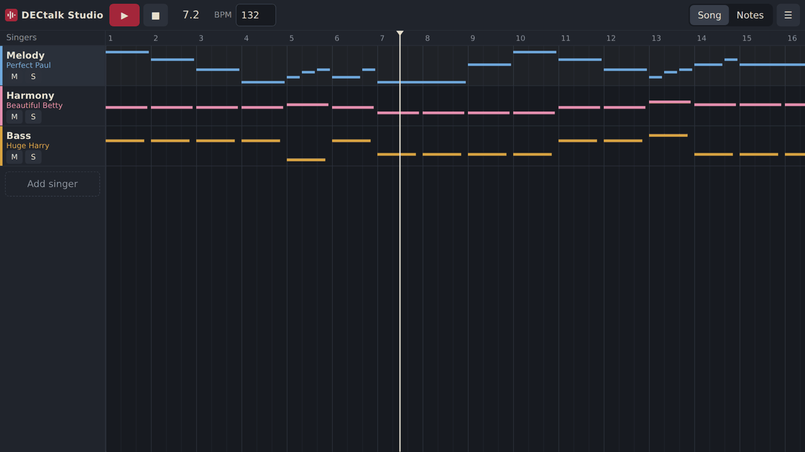
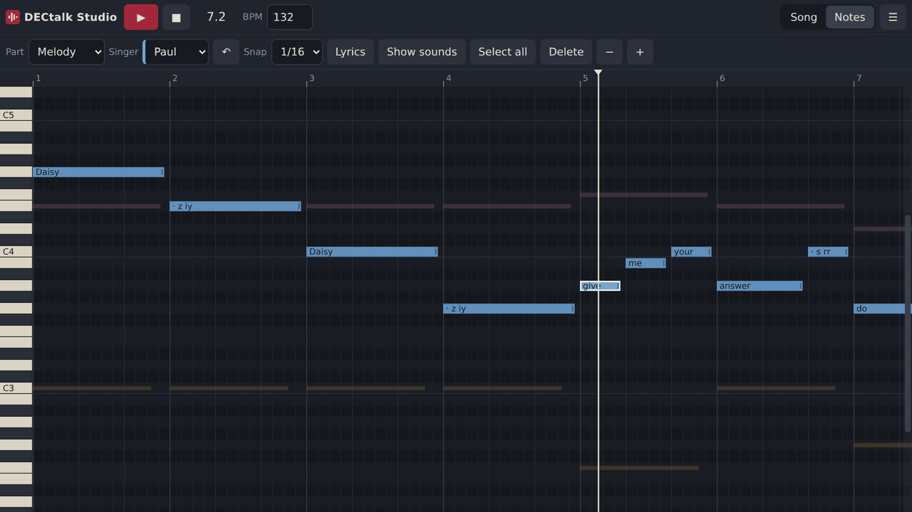
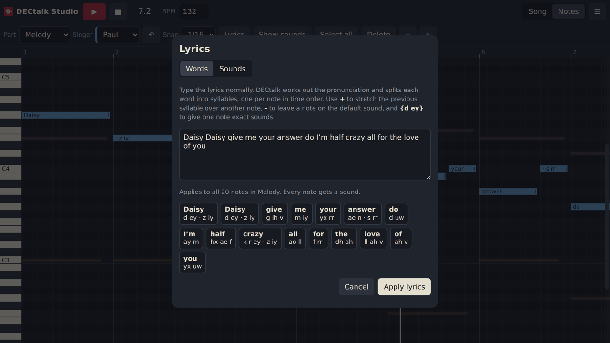
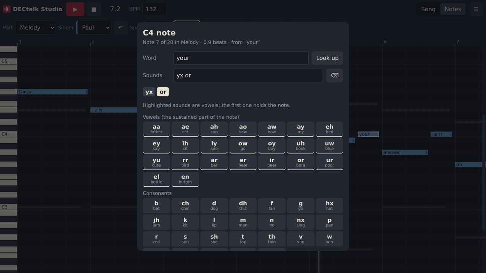
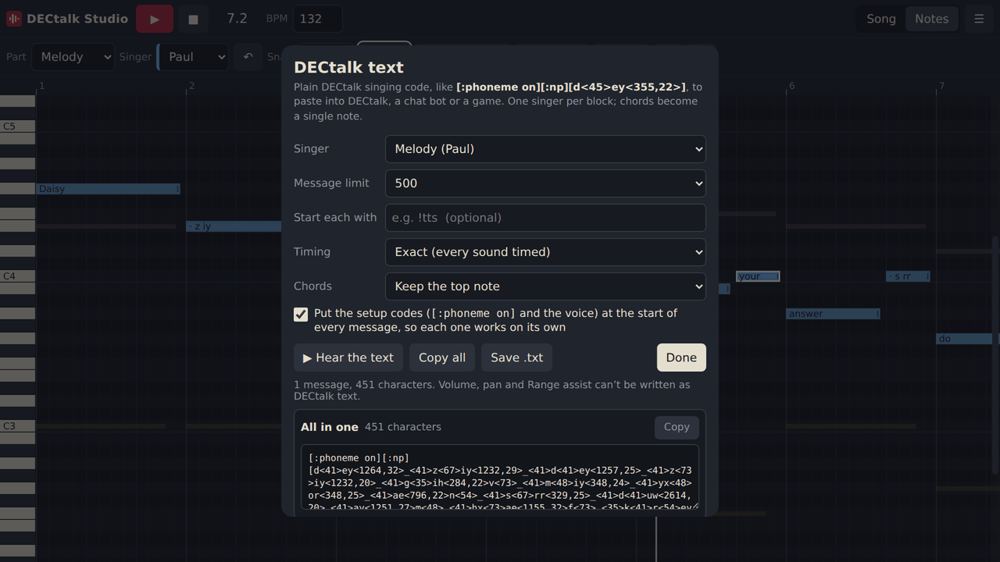

# DECtalk Studio

A multitrack singing editor that uses **DECtalk**, the classic 1980s–90s speech synthesizer, as its voice. Write or import a song, give each part a DECtalk singer and lyrics, and hear it sung. It runs as a web page (DECtalk compiled to WebAssembly, nothing to install) and as an Android app.



> **Unofficial project.** DECtalk is proprietary software owned by others; see [Licensing](#licensing) before publishing builds.

## Features

- **Multitrack.** Each part is a *singer*: Perfect Paul, Beautiful Betty, Huge Harry, Frail Frank, Doctor Dennis, Kit the Kid, Uppity Ursula, Rough Rita or Whispering Wendy, with volume, pan, mute, solo and octave shift. Chords in a part are fine: every note is rendered separately.
- **Piano-roll editing.** Add, move, resize, select (box, Shift/Ctrl-click, select all), copy, paste, duplicate and delete notes; snap; zoom; undo.
- **Lyrics from plain English.** Type lyrics normally and DECtalk's own dictionary and letter-to-sound rules turn them into phonemes, split into syllables, one per note. `+` stretches a syllable over the next note, `-` skips a note, `{d ey}` gives a note exact sounds.
- **Per-note sound editor.** Long-press (touch) or double-click (mouse) a note to edit its phonemes: word lookup, a palette of every DECtalk sound with example words, and live checking.
- **Custom default sounds.** Each singer's default (what notes without lyrics sing) can be a preset like `laa`, or any sound you build in the editor; your custom sounds are remembered.
- **MIDI import.** Reads tempo, time signature and track names, splits parts by channel, skips drums.
- **Part splitting.** Separate a part into **left and right hand** (follows each hand through the piece, coping with hands that cross middle C), **at a chosen note**, or into **single-note lines** (top, middle, bottom) so each line can have its own singer.
- **Range assist.** DECtalk only sings C2–C5 natively. Notes from G1 to F5 are sung at their true pitch, high notes get clearer vowels, low notes less buzz, and loudness is evened out. One slider per singer, from Natural to Clearest.
- **Exports.** WAV (mixdown), project files (`.json`), and **DECtalk text**: classic singing code such as `[:phoneme on][:np][d<41>ey<1270,32>…]` for DECtalk itself, chat bots and games, optionally split into messages under a character limit (2,000 for Discord, or any number).
- **Keyboard and mouse.** Full shortcuts on desktop (press `?` in the app); touch gestures on phones.

| Notes view, with lyrics | Lyrics from plain English |
|---|---|
|  |  |

| Per-note sound editor | DECtalk text export |
|---|---|
|  |  |

## Getting it

**In a browser.** Build it (below) and open `dist/dectalk-studio.html`. It's a single self-contained file: the engine and dictionary are embedded, it works offline from disk, and nothing is uploaded. It needs a current browser with WebAssembly and `DecompressionStream`; it's tested in Chromium (Chrome, Edge). If you host it, the server must allow WebAssembly (a Content-Security-Policy without `'wasm-unsafe-eval'` blocks it; the page then says so).

**On Android.** Install `dist/DECtalkStudio.apk` (Android 6.0 or later; ARM 64-bit, ARM 32-bit or x86-64). It's sideloaded, so Android will ask you to allow installs from that source.

If this repository has releases, both files are attached there.

## Using it

- **Song view** shows every singer on a timeline. Click a singer's name for its settings (voice, default sound, volume, pan, Range assist, octave, split, duplicate, delete). The wheel scrolls through singers; Shift+wheel scrolls the timeline; drag the scroll bar for big imports.
- **Notes view** edits one part. **Part** picks which part; **Singer** picks who sings it (lyrics stay with the notes). Click empty space to add a note, drag to move, drag the right edge to resize, right-click to delete.
- **Lyrics** (toolbar button or `L`): type words in the *Words* tab; a preview shows how syllables land on notes before you apply. The *Sounds* tab takes phonemes directly, one note per `/`.
- **Split…** is in each singer's settings. After a MIDI import, the app points you to it when a part has chords.
- **Export** (menu ☰): *Export song as WAV*, *Export as DECtalk text*, *Save project*.

Common shortcuts: `Space` play/pause · `Home` back to start · `Tab` switch views · `Ctrl+Z` undo · arrows move selected notes (`Shift` to resize or jump an octave) · `Ctrl+C`/`X`/`V`/`D` copy, cut, paste at the playhead, duplicate · `Enter` edit the selected note's sounds · `Esc` close a panel.

## DECtalk text export

DECtalk sings phonemes in brackets, each with a length in milliseconds and, for vowels, a pitch number (1–37 = C2–C5):

```
[:phoneme on][:nb][d<41>ey<1270,32>_<41>z<73>iy<1238,29>]
```

The exporter keeps songs in time, which naive text doesn't. Measured against DECtalk:

- With a length on the vowel only, consonants add time and an 8-note line ran **16% slow**. *Exact* mode gives every sound its own length.
- DECtalk rounds every sound to whole frames, `frames = floor((ms + 4) / 6.4)`, and each frame lasts 71 samples at its 11,025 Hz output (6.44 ms). The exporter tracks where DECtalk will really be and picks each length so rounding never accumulates.
- Result: a 2.7-minute, 300-note test song stays within about **0.1 s** (*Exact*) or **0.2 s** (*Compact*, about a third fewer characters, consonant lengths left to DECtalk).

Splitting into messages happens between notes, preferring rests, and each message carries its own setup codes so it works on its own. An optional prefix (for example `!tts `) can start every message. Each part is exported on its own and DECtalk sings one note at a time, so chords keep only their top (or bottom) note; split a part into single-note lines first to keep everything. Volume, pan and Range assist can't be expressed as DECtalk text.

## How it works

Both versions share one interface: `android/assets/web/index.html`.

**Android** shows that page in a WebView. DECtalk runs as a separate process: `engine/dtserver.c` wraps DECtalk's API in a tiny line-based server (`<file.wav>\t<text>` renders; `PHON\t<log>\t18\t<text>` writes DECtalk's phoneme and syllable log). It's cross-compiled with zig as a static musl executable and shipped as `lib/<abi>/libdtserver.so`, so Android installs it where apps may run executables. The page reaches it through intercepted requests (`/dt/render`, `/dt/phonemes`).

**The web version** runs DECtalk inside the page:

- DECtalk is compiled to `wasm32-wasi`. It's multithreaded, but every thread operation goes through one wrapper (`opthread.c`), so `web/fb.h` redirects those calls to `web/fiber.c`: **cooperative green threads** that yield wherever a real thread would block.
- [Binaryen Asyncify](https://github.com/WebAssembly/binaryen) lets `web/engine.js` pause a green thread's stack and switch to the next, round-robin, on the page's single thread. No SharedArrayBuffer or special server headers are needed.
- `engine.js` also provides a small in-memory WASI file system for `DECtalk.conf`, the dictionary and rendered WAVs; `web/audio_stub.c` replaces the Linux sound-card layer.
- Output is bit-identical to the native build. The page embeds the gzipped engine and dictionary (about 400 KB) and starts in about half a second.

**Lyrics** come from DECtalk itself: the engine logs its phonemes and syllable breaks for the text, and the app aligns the two. Each word is sent as its own clause so words map one-to-one, and reduced vowels (`ax`, `ix`) are sung as full vowels. DECtalk's names `y` and `h` are invalid (it says "command error" instead), so the app writes `yx` and `hx`.

**Range assist** was tuned by measurement: vowel distinctness at high pitch (a smaller DECtalk head size helps the deep male voices; the female voices degrade past about 6%), buzz and loudness at low pitch, and head-size-compensated pitch shifting beyond DECtalk's range.

## Building from source

Tested on Ubuntu 24.04. You need git, Python 3, gcc, make, autoconf, automake and libtool; zig **0.13** (`pip install ziglang==0.13.0` provides it as `python3 -m ziglang`); Node.js (for Binaryen's `wasm-opt`, fetched with `npx`); and for Android, a JDK plus `android-sdk-platform-23 aapt zipalign apksigner dalvik-exchange`.

```sh
git clone --recursive <this repo>
cd dectalk-studio

scripts/build-dectalk.sh     # DECtalk's own Linux build: dictionary + generated headers (~2 min)
scripts/build-web.sh         # -> dist/dectalk-studio.html
scripts/build-native.sh      # Android engines -> android/lib/*, dictionary -> android/assets/dectalk/
android/build-apk.sh         # -> dist/DECtalkStudio.apk
```

DECtalk is a git submodule at `third_party/dectalk`, pinned to upstream commit `986ea12` (the version this project is built and measured against). If you cloned without `--recursive`, run `git submodule update --init`.

Settings, via environment variables:

| Variable | Default | Used by |
|---|---|---|
| `DECTALK_DIR` | `third_party/dectalk` | all scripts |
| `ZIG13` | `python3 -m ziglang` | `build-web.sh`; must be zig 0.13 (the newer clang in later zig crashes compiling DECtalk's synthesizer for WebAssembly) |
| `ZIG` | `zig` if on PATH, else `python3 -m ziglang` | `build-native.sh` |
| `WASM_OPT` | `npx --yes -p binaryen@116.0.0 wasm-opt` | `build-web.sh` |
| `ANDROID_SDK` | `/usr/lib/android-sdk` | `build-apk.sh` |
| `KEYSTORE`, `KEYSTORE_PASS` | `android/release.keystore`, `dectalk` | `build-apk.sh` |

**Signing.** `build-apk.sh` creates a signing key on first run. Set your own `KEYSTORE_PASS`, keep the key safe, and never commit it (`.gitignore` excludes `*.keystore`). Android only installs an update over an existing copy if it's signed with the same key, so switching keys means uninstalling the old app first.

A clean build from a fresh clone reproduces the engines byte-for-byte, apart from the build date DECtalk compiles in.

## Repository layout

```
android/            Android app: manifest, Java host (WebView + engine process), icon, build-apk.sh
  assets/web/       the app's interface, shared with the web version
engine/             dtserver.c (DECtalk render server) and the list of DECtalk objects to compile
web/                WebAssembly build: green threads (fiber.c, fb.h), API (dtweb.c), audio stubs,
                    JS host (engine.js), page builder (build_page.py)
scripts/            build-dectalk.sh, build-native.sh, build-web.sh, xbuild.py (parallel cross-compiler)
docs/screenshots/   images for this README
third_party/dectalk DECtalk source (git submodule, not part of this project)
```

## Known limitations

- On touch screens, multi-selection is one note at a time or *Select all* (no box selection; dragging scrolls).
- DECtalk text holds one note at a time per part; volume, pan and Range assist aren't exported to text.
- Only US English is built.

## Licensing

**DECtalk is not open source.** Its licence (in the [dectalk/dectalk](https://github.com/dectalk/dectalk) repository) states that the software is proprietary to FONIX Corporation and that possession, use or copying requires a valid written licence. This repository therefore does **not** include DECtalk's source; it's referenced as a submodule. However, the built APK and web page **contain compiled DECtalk and its dictionary**, so publishing those builds carries DECtalk's licensing question. Consider that before attaching binaries to releases or hosting the page. This isn't legal advice.

The code written for this project (interface, green-thread layer, render server, build scripts) is separate from DECtalk. <!-- Choose a licence for it (for example MIT), add a LICENSE file, and replace this line. -->

## Credits

DECtalk was created at Digital Equipment Corporation and later developed by Force Computers, SMART Modular Technologies and Fonix. Thanks to the maintainers of [dectalk/dectalk](https://github.com/dectalk/dectalk) for the working Linux build this project compiles from, and to the [Binaryen](https://github.com/WebAssembly/binaryen) and [Zig](https://ziglang.org) projects.
